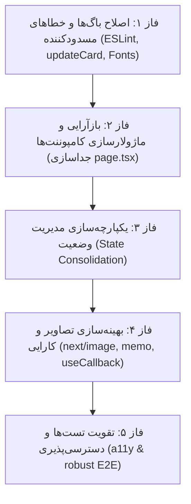

# بازبینی جامع کد پروژه کانبان (LOOM Code Review)

## ۱. مقدمه و چکیده اجرایی

این سند نتیجه بازبینی عمیق و همه‌جانبه کد (Comprehensive Code Review) پروژه کانبان LOOM است. در این بررسی، تمام لایه‌های برنامه شامل مدل داده، معماری کامپوننت‌ها، سیستم استایل‌دهی، تست‌ها، کارایی، دسترسی‌پذیری و انطباق با استانداردها ارزیابی شده‌اند.

هدف از این گزارش، شناسایی خطاها، ریسک‌های بالقوه فنی، ضدالگوها (Anti-patterns) و ارائه راهکارهای اصلاحی دقیق و گام‌به‌گام برای ارتقای کیفیت و پایداری کدبیس است. مطابق درخواست، هیچ تغییری در کدهای پروژه اعمال نشده و تمام موارد در قالب این سند مستند گردیده‌اند.

---

## ۲. خلاصه وضعیت سلامت پروژه

| شاخص | وضعیت فعلی | توضیح |
| :--- | :--- | :--- |
| خطاهای لینتر (ESLint) | ۱ خطا و ۷ هشدار | خطای مسدودکننده در استفاده از تگ `<a>` به جای `<Link>` و هشدارهای تگ `` |
| بیلد پروداکشن (`next build`) | شکست در محیط آفلاین | وابستگی بیلد به دانلود برخط فونت‌ها از Google Fonts |
| تست‌های واحد (`vitest`) | ۹ پاس | پوشش پایه خوب برای توابع خالص تخته، اما فاقد پوشش باگ‌های زبانی |
| ساختار کد و ماژولار بودن | نیازمند بازآرایی | انباشتگی بیش از ۸۳۰ خط کد در یک کامپوننت واحد (`page.tsx`) |
| همگام‌سازی وضعیت (State Sync) | دارای ریسک ناهمگامی | جداسازی داده‌های اصلی از متادیتا در سه `useState` مجزا |

---

## ۳. بررسی دقیق مشکلات و ریسک‌های شناسایی‌شده

### ۳.۱. خطاهای مسدودکننده و باگ‌های منطقی (Critical & High Severity)

#### الف) خطای لینت مسدودکننده در ناوبری (`@next/next/no-html-link-for-pages`)
- **محل خطا**: فایل `src/app/page.tsx`، سطر ۶۶۳
- **کد فعلی**:
  ```tsx
  <a className="brand-lockup" href="/" aria-label={labels.product}>
    
  </a>
  ```
- **علت و اثر**: استفاده از تگ استاندارد `<a>` برای روت داخلی در Next.js باعث رفرش کامل صفحه (Full Page Reload) و نابودی وضعیت درون حافظه‌ای برنامه می‌شود. همچنین دستور `npm run lint` با خطای کد ۱ خارج می‌شود.
- **اقدام اصلاحی موردنیاز**: جایگزینی با کامپوننت `<Link>` از پکیج `next/link`.

#### ب) باگ منطقی در به‌روزرسانی کارت‌های چندزبانه (`updateCard`)
- **محل خطا**: فایل `src/lib/board.ts`، سطر ۱۶۳
- **کد فعلی**:
  ```typescript
  export function updateCard(
    board: BoardState,
    cardId: string,
    title: string,
    details: string,
  ): BoardState {
    const cleanTitle = title.trim();
    const card = board.cards.find((item) => item.id === cardId);
    if (!card || !cleanTitle) return board;

    const cleanDetails = details.trim();
    if (card.title.en === cleanTitle && card.details.en === cleanDetails) return board;
    // ...
  }
  ```
- **علت و اثر**: تابع شرط عدم تغییر را فقط با زبان انگلیسی (`card.title.en` و `card.details.en`) مقایسه می‌کند. اگر کاربر در محیط فارسی (`fa`) متنی را ویرایش کند یا متنی مشابه متن انگلیسی وارد کند، گارد کنترلی رفتار غیرمنتظره نشان داده و ممکن است از ذخیره تغییرات جلوگیری کند یا در صورت تغییر، متن انگلیسی اولیه کارت را با متن فارسی بازنویسی نماید.
- **اقدام اصلاحی موردنیاز**:
  ۱. اضافه کردن پارامتر `locale: Locale` به ورودی تابع `updateCard`.
  ۲. بررسی برابری متن با زبان جاری:
     ```typescript
     if (card.title[locale] === cleanTitle && card.details[locale] === cleanDetails) return board;
     ```
  ۳. به‌روزرسانی فقط فیلد مربوط به زبان جاری در شیء `LocalizedText` یا تفکیک شفاف بین بازنویسی هر دو زبان و حفظ زبان دوم.

#### ج) خطای بیلد به دلیل وابستگی فونت گوگل در محیط‌های بدون اینترنت
- **محل خطا**: فایل `src/app/layout.tsx`، سطر ۲ تا ۱۵
- **کد فعلی**:
  ```typescript
  import { Plus_Jakarta_Sans, Vazirmatn } from "next/font/google";
  ```
- **علت و اثر**: اجرای `next build` برای کامپایل استاتیک نیاز به دانلود فایل‌های فونت از سرورهای گوگل (`fonts.googleapis.com`) دارد. در صورت قطعی اینترنت، استفاده از فیلترشکن، یا استقرار در سرورهای با دسترسی محدود، بیلد بلافاصله با خطای Turbopack مواجه شده و فرآیند CI/CD شکست می‌خورد.
- **اقدام اصلاحی موردنیاز**: دانلود فونت‌های `woff2` مربوط به Vazirmatn و Plus Jakarta Sans و میزبانی محلی آنها با استفاده از `next/font/local`.

---

### ۳.۲. معماری و ساختار کامپوننت‌ها (Medium Severity)

#### الف) کامپوننت یکپارچه و غول‌پیکر (`page.tsx`)
- **توضیح**: فایل `src/app/page.tsx` دارای ۸۳۱ سطر کد است و هم‌زمان تعریف استیت اصلی، توابع کمکی، کامپوننت `BoardCard`، کامپوننت `BoardColumn`، پیکربندی ترجمه‌ها و نمونه‌داده‌های تستی را در خود جای داده است.
- **پیامد**:
  - کاهش شدید خوانایی و افزایش هزینه نگهداری.
  - تست‌پذیری دشوار کامپوننت‌های فرعی.
  - نقض اصل تک‌مسئولیتی (Single Responsibility Principle).
- **اقدام اصلاحی موردنیاز**:
  تفکیک فایل به ساختار ماژولار زیر:
  - `src/components/board/BoardColumn.tsx`
  - `src/components/board/BoardCard.tsx`
  - `src/components/board/CardEditForm.tsx`
  - `src/components/layout/Sidebar.tsx`
  - `src/components/layout/TopBar.tsx`
  - `src/lib/constants.ts` (برای دیکشنری‌های ترجمه، نمونه‌عکس‌ها و لیست‌های اولویت)

#### ب) چندپارگی وضعیت (State Fragmentation) و ناهماهنگی در پاک‌سازی
- **توضیح**: در `BoardPage`، سه وضعیت موازی به صورت جداگانه مدیریت می‌شوند:
  ```typescript
  const [board, setBoard] = useState<BoardState>(...);
  const [likedIds, setLikedIds] = useState<Record<string, boolean>>({});
  const [cardMeta, setCardMeta] = useState<Record<string, CardMeta>>(...);
  ```
  هنگام حذف کارت، باید سه عملیات متوالی انجام شود:
  ```typescript
  function onDeleteCard(cardId: string) {
    setBoard((current) => deleteCard(current, cardId));
    setCardMeta((current) => { ... delete next[cardId]; ... });
    setLikedIds((current) => { ... delete next[cardId]; ... });
  }
  ```
- **پیامد**: اگر در توسعه‌های آتی توسعه‌دهنده‌ای تابع حذف یا تغییر دیگری بنویسد و یکی از این سه استیت را فراموش کند، نشست حافظه (Memory Leak) و متادیتای یتیم (Orphan Metadata) به وجود می‌آید.
- **اقدام اصلاحی موردنیاز**: ادغام این ساختارها در یک مدل یکپارچه یا استفاده از الگوی `useReducer` برای مدیریت یکپارچه اکشن‌ها.

#### ج) اسکریپت نامتعارف در چیدمان اصلی (`layout.tsx`)
- **توضیح**: در سطرهای ۲۹ تا ۳۳ فایل `src/app/layout.tsx` کد زیر وجود دارد:
  ```tsx
  <script
    dangerouslySetInnerHTML={{
      __html: "document.body.removeAttribute('location')",
    }}
  />
  ```
- **علت و پیامد**: این کد احتمالاً برای برطرف کردن رفتار ناخواسته یک افزونه مرورگر (مانند اکستنشن‌های ترنسلیت یا ولت) به صورت موقت اضافه شده است. قرار دادن اسکریپت درون‌خطی در روت لی‌اوت بدون کامنت توضیحی، ریسک امنیتی و ابهام معماری ایجاد می‌کند.
- **اقدام اصلاحی موردنیاز**: حذف این اسکریپت یا مستندسازی دلیل قطعی حضور آن همراه با بررسی عدم وجود راه‌حل تمیزتر.

---

### ۳.۳. کارایی، رندرینگ و بهینه‌سازی دارایی‌ها (Medium / Low Severity)

#### الف) هشدارهای مربوط به عدم استفاده از `<Image />` در Next.js
- **توضیح**: در هفت نقطه از فایل `page.tsx` از تگ استاندارد `` برای آواتارها و لوگوها استفاده شده است.
- **پیامد**: لود شدن تصاویر با سایز و فرمت اصلی، فقدان Lazy Loading بومی، افزایش LCP (Largest Contentful Paint) و ایجاد هشدارهای متعدد لینتر در زمان توسعه.
- **اقدام اصلاحی موردنیاز**:
  ۱. استفاده از `next/image`.
  ۲. اضافه کردن دامنه تصاویر Unsplash به فایل `next.config.ts`:
     ```typescript
     images: {
       remotePatterns: [
         {
           protocol: "https",
           hostname: "images.unsplash.com",
         },
       ],
     },
     ```

#### ب) بازرندرهای غیرضروری (Unnecessary Re-renders)
- **توضیح**: در کامپوننت `BoardPage`، هیچ‌یک از کامپوننت‌های `BoardColumn` و `BoardCard` توسط `React.memo` محافظت نشده‌اند و توابع کنترلی (`onLike`, `onSaveCard`, `finishDrag`) در `useCallback` محصور نیستند.
- **پیامد**: هنگام تایپ کاربر در فیلد جست‌وجو یا درگ کردن یک کارت، تمام ۵ ستون و تمامی کارت‌های تخته مجدداً ارزیابی و رندر می‌شوند. در صورتی که تعداد کارت‌ها افزایش یابد، لگ و افت فریم مشهود خواهد بود.
- **اقدام اصلاحی موردنیاز**: محصورسازی توابع هندلر با `useCallback` و استفاده از `memo` برای کامپوننت‌های فرعی.

---

### ۳.۴. دسترسی‌پذیری و رابط کاربری (Accessibility / a11y)

#### الف) نقص در برچسب‌گذاری فیلدهای فرم ویرایش کارت
- **توضیح**: در فرم ویرایش کارت (`BoardCard`)، برچسب‌های `labels.status`، `labels.priority`، `labels.accent` و `labels.assignee` فاقد مشخصه `htmlFor` بوده و کنترل‌های مربوطه شناسه `id` متناظر ندارند.
- **پیامد**: کاربران صفحه‌خوان (Screen Readers) متوجه نمی‌شوند هر بخش ورودی یا دکمه‌های رادیویی مربوط به کدام عنوان است.
- **اقدام اصلاحی موردنیاز**: اتصال برچسب‌ها با ایجاد شناسه‌های یکتا به کمک `useId` و انتساب `htmlFor` و `id`.

#### ب) عدم وجود اعلام وضعیت صوتی برای درگ و دراپ (ARIA Live Region)
- **توضیح**: جابه‌جایی کارت‌ها با کیبورد یا ماوس هیچ پیام صوتی تولید نمی‌کند.
- **اقدام اصلاحی موردنیاز**: استفاده از بخش Accessibility در `@dnd-kit/core` برای خواندن تغییرات (مانند: "کارت به ستون در حال انجام منتقل شد").

---

### ۳.۵. کیفیت و استراتژی تست (Testing Strategy)

#### الف) شکنندگی تست‌های E2E با مختصات ثابت در درگ و دراپ
- **محل خطا**: فایل `e2e/board.spec.ts`، سطر ۵۳
- **کد فعلی**:
  ```typescript
  await card.dragTo(destination, {
    targetPosition: { x: 140, y: 110 },
  });
  ```
- **پیامد**: تکیه بر مختصات پیکسلی سخت‌کدشده (`x: 140, y: 110`) باعث می‌شود با کوچک‌ترین تغییر در فاصله حاشیه‌ها (Padding)، تغییر فونت، یا تغییر ابعاد صفحه تست، سناریوی تست بدون وجود باگ واقعی Fail شود.
- **اقدام اصلاحی موردنیاز**: استفاده از رویکرد جابه‌جایی بر مبنای سلکتور کارت مقصد یا شبیه‌سازی درگ کیبوردی به جای موقعیت مطلق پیکسلی.

#### ب) شکاف در تست‌های واحد برای سناریوهای مرزی
- **توضیح**: در `board.test.ts` هیچ تستی برای سناریوی ویرایش متن کارت در محیط فارسی (`updateCard`)، مقادیر تکراری، یا مدیریت شناسه‌های یکسان وجود ندارد.
- **اقدام اصلاحی موردنیاز**: افزودن تست‌های واحد متمرکز بر تغییرات زبان و اعتبارسنجی مقادیر متنی.

---

## ۴. برنامه اقدام اصلاحی گام‌به‌گام (Remediation Plan)

برای پیاده‌سازی اصلاحات بدون ایجاد تداخل، ترتیبات پیشنهادی زیر بر اساس اولویت توصیه می‌شود:



### فاز ۱: رفع خطاهای مسدودکننده (فوری)
1. تبدیل تگ `<a>` به `<Link>` در هدر ناوبری `src/app/page.tsx` برای سبز شدن بیلد لینتر.
2. اصلاح تابع `updateCard` در `src/lib/board.ts` به گونه‌ای که برابری متن را متناسب با لوکال فعال بسنجد و متن زبان دیگر را مخدوش نکند.
3. اضافه کردن فونت‌های محلی برای تضمین بیلد بدون وابستگی به اینترنت.

### فاز ۲: تفکیک ساختار و کامپوننت‌ها
1. استخراج `BoardColumn` و `BoardCard` به پوشه اختصاصی `src/components/board/`.
2. انتقال متغیرهای ثابت، نمونه‌داده‌ها و دیکشنری ترجمه به پوشه `src/lib/`.
3. کوچک‌سازی `page.tsx` به یک کامپوننت هماهنگ‌کننده سطح بالا با کمتر از ۱۵۰ سطر کد.

### فاز ۳: اصلاح مدیریت وضعیت
1. تجمیع وضعیت‌های `board`، `cardMeta` و `likedIds` در یک استیت واحد یا تعریف هوک اختصاصی `useBoardState` با استفاده از `useReducer`.
2. تضمین انجام تمامی عملیات حذف، افزودن و جابه‌جایی کارت به صورت اتمیک.

### فاز ۴: بهینه‌سازی تصویر و رندر
1. پیکربندی دامنه `images.unsplash.com` در `next.config.ts`.
2. جایگزینی `` با کامپوننت `<Image />` به همراه ابعاد مشخص و حالت لود تنبل.
3. استفاده از `React.memo` برای کامپوننت‌های ستون و کارت جهت جلوگیری از رندرهای اضافی هنگام تایپ در سرچ.

### فاز ۵: ارتقای دسترسی‌پذیری و تست‌ها
1. پیوند دادن تمامی برچسب‌های فرم ویرایش کارت به فیلدهای ورودی از طریق `htmlFor` و `id`.
2. بازنویسی تست درگ و دراپ Playwright جهت پرهیز از تکیه بر پیکسل‌های سخت‌کدشده.

---

## ۵. نتیجه‌گیری

کدبیس فعلی دارای پایه‌ای تمیز، منطق عملکردی خالص، تایپ‌های منسجم و استایل‌بندی مدرن است. رعایت نکاتی چون جداسازی لایه داده از لایه نمایش و پشتیبانی بومی از راست‌به‌چپ نقاط قوت شاخص پروژه هستند.

با اعمال اصلاحات فوق—به‌ویژه رفع خطای لینتر ناوبری، تصحیح تابع ویرایش کارت، ماژولارسازی فایل‌های طولانی و پایدارسازی فرآیند بیلد—این پروژه از سطح یک نمونه آزمایشی به یک محصول کاملاً حرفه‌ای و آماده مقیاس‌پذیری در مقیاس صنعتی ارتقا خواهد یافت.
