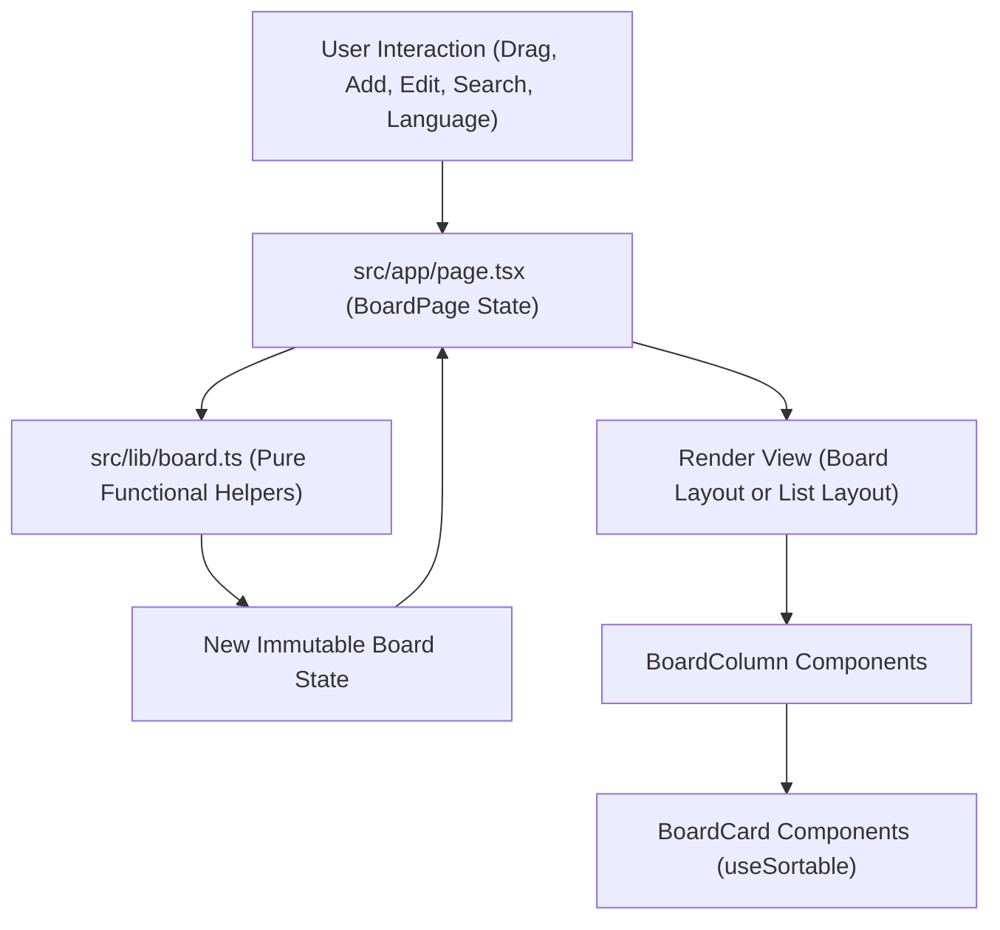

# LOOM Kanban Board: Frontend Architecture and Implementation Tutorial

## 1. Introduction and Purpose

This tutorial walks through the architecture, design decisions, and code implementation of the **LOOM** Kanban board application. It is written specifically for developers who are beginning their journey in modern frontend development.

A Kanban board is a visual project management tool designed to help teams visualize work, limit work-in-progress, and maximize efficiency. In this project, LOOM provides a single-board interface with five fixed workflow stages:

- **New Requests (`backlog`)**: Incoming tasks and raw ideas.
- **Assigned (`todo`)**: Work planned and scheduled for execution.
- **In Progress (`in-progress`)**: Tasks currently being developed.
- **Approved (`review`)**: Tasks under review or quality assurance.
- **Done (`done`)**: Completed tasks.

### Core Goals of the Implementation
- **Zero Backend Complexity**: State lives in browser memory, making the application snappy, completely self-contained, and ideal for studying pure frontend patterns.
- **Bilingual and Bidirectional (L10n / i18n)**: Full support for both English (LTR: Left-to-Right) and Persian (RTL: Right-to-Left), complete with appropriate typography.
- **Interactive Drag-and-Drop**: Fluid card movement across columns and within columns using modern drag-and-drop primitives.
- **Clean Separation of Concerns**: Complete isolation between business logic (data manipulation) and view logic (rendering user interface).

---

## 2. Technology Stack Summary

Modern frontend development relies on a collection of specialized tools. Below is an overview of each tool used in this project and why it was chosen.

### Next.js 16 (App Router)
- **What it is**: Next.js is a production-grade framework built on top of React. It handles bundling, optimization, file-based routing, and rendering strategies.
- **Why we use it**: It provides optimized font loading, simple deployment pipelines (such as Vercel), and structured layouts. In this app, we mark our interactive entry point with `"use client"`, which instructs Next.js to render and hydrate the interface in the client browser.

### React 19
- **What it is**: A declarative JavaScript library for building component-based user interfaces.
- **Key Concepts used**:
  - **Components**: Self-contained functions that return JSX (HTML-like syntax inside JavaScript).
  - **State (`useState`)**: Variables that cause the component to re-render when their values change.
  - **Side Effects (`useEffect`)**: Running code in response to state changes (such as switching the HTML document's direction from LTR to RTL).
  - **Accessibility IDs (`useId`)**: Generating unique, deterministic HTML IDs for linking form inputs and labels.

### TypeScript 5
- **What it is**: A typed superset of JavaScript that compiles down to plain JavaScript.
- **Why we use it**: Beginners often run into silent runtime errors (such as misspelling an object property or passing undefined to a function). TypeScript catches these bugs in your editor before the code ever runs.

### @dnd-kit (React & DOM)
- **What it is**: A lightweight, modular, and accessible drag-and-drop toolkit for React.
- **Why we use it**: Many drag-and-drop libraries rely on native HTML5 Drag and Drop APIs, which suffer from poor mobile touch support and awkward styling limitations. `@dnd-kit` uses PointerEvents, supports smooth CSS transforms, and provides fine-grained control over drag states.

### Lucide React
- **What it is**: An open-source, tree-shakeable icon library.
- **Why we use it**: Clean, consistent SVG icons with adjustable stroke widths and sizes, easily styled with CSS classes.

### Tailwind CSS v4 & CSS Custom Properties
- **What it is**: A utility-first CSS framework coupled with native CSS design tokens.
- **Why we use it**: We define design tokens in `:root` (such as `--brand: #6d4aff;` and `--brand-surface: #ece9ff;`), creating a single source of truth for colors, elevations, and layout dimensions.

### Vitest & Playwright
- **Vitest**: A fast unit-testing framework used to test our pure state management functions in milliseconds.
- **Playwright**: An end-to-end (E2E) browser automation framework that tests user workflows directly in a real browser instance.

---

## 3. High-Level Architectural Walkthrough

Before inspecting individual lines of code, let us observe how data and user interactions flow through the application.



### The Three Structural Pillars
1. **The Pure Logic Engine (`src/lib/board.ts`)**:
   Contains no UI elements, no HTML, and no React hooks. It only knows about data types and how to transform them. Given an input state and an action, it computes and returns the new state. This makes it 100% predictable and simple to unit test.
2. **The View & Orchestrator (`src/app/page.tsx`)**:
   Contains the React components. It holds the current board state in a `useState` hook, handles user inputs (clicks, drags, keyboard events), calls the pure logic engine to obtain updated states, and distributes props down to child components.
3. **The Presentation & Style System (`src/app/globals.css` & `src/app/layout.tsx`)**:
   Manages internationalized fonts (`Plus_Jakarta_Sans` for Latin characters and `Vazirmatn` for Persian), bidirectional CSS attributes (`dir="ltr"` / `dir="rtl"`), and color tokens for columns, cards, and buttons.

---

## 4. Detailed Code Review with Code Samples

Let us walk through each core file step-by-step.

### 4.1 Data Models and Pure Functions (`src/lib/board.ts`)

In frontend development, defining clear data structures early is one of the best practices you can adopt.

#### Type Definitions
```typescript
export type Locale = "en" | "fa";

export type LocalizedText = Record<Locale, string>;

export type Column = {
  id: string;
  name: LocalizedText;
};

export type Card = {
  id: string;
  columnId: string;
  title: LocalizedText;
  details: LocalizedText;
};

export type BoardState = {
  columns: Column[];
  cards: Card[];
};
```
- `Locale`: A union type allowing only `"en"` or `"fa"`. This prevents typos.
- `LocalizedText`: A TypeScript record where both `"en"` and `"fa"` keys map to strings: `{ en: "Hello", fa: "سلام" }`.
- `BoardState`: The single source of truth containing a list of `columns` and a flat list of `cards`. Each card points to its column via `columnId`.

#### The Immutability Principle
In React, you must **never directly mutate state objects or arrays**. Instead of `board.cards.push(newCard)`, we always create a new copy with the update applied.

Let us examine `addCard`:

```typescript
export function addCard(
  board: BoardState,
  columnId: string,
  title: string,
  details: string,
  id: string,
): BoardState {
  const cleanTitle = title.trim();
  const columnExists = board.columns.some((column) => column.id === columnId);

  // Guard clause: if title is blank or column does not exist, return original state
  if (!cleanTitle || !columnExists) return board;

  return {
    ...board,
    cards: [
      ...board.cards,
      {
        id,
        columnId,
        title: text(cleanTitle, cleanTitle),
        details: text(details.trim(), details.trim()),
      },
    ],
  };
}
```
**Why this matters for beginners**:
- `title.trim()` strips accidental whitespace from the start and end of strings.
- `board.columns.some(...)` ensures we do not attach a card to an invalid column ID.
- The spread operator `...board.cards` copies the existing cards into a new array, appending the new item. Because React detects changes by checking if object references have changed, returning a new array ensures React knows to re-render.

#### Moving and Reordering Cards (`moveCard`)
Moving cards is the most critical operation in a Kanban board. Cards can be moved between columns, or reordered within the same column:

```typescript
export function moveCard(
  board: BoardState,
  cardId: string,
  targetColumnId: string,
  beforeCardId?: string,
): BoardState {
  const card = board.cards.find((item) => item.id === cardId);
  const targetExists = board.columns.some((column) => column.id === targetColumnId);

  if (!card || !targetExists || (beforeCardId === cardId && card.columnId === targetColumnId)) {
    return board;
  }

  // 1. Remove the moving card from the existing list
  const remaining = board.cards.filter((item) => item.id !== cardId);

  // 2. Prepare the updated card with its new column assignment
  const nextCard = { ...card, columnId: targetColumnId };

  // 3. Locate where to insert it
  const targetCardIndex = beforeCardId
    ? remaining.findIndex(
        (item) => item.id === beforeCardId && item.columnId === targetColumnId,
      )
    : -1;

  // 4. Splice it into place or append to the end of the column
  if (targetCardIndex >= 0) remaining.splice(targetCardIndex, 0, nextCard);
  else remaining.push(nextCard);

  return { ...board, cards: remaining };
}
```
Notice how clean this is: whether the card moved to another column or was dragged above a sibling card in the same column, `moveCard` handles both cases consistently.

---

### 4.2 Layout and Bilingual Font Setup (`src/app/layout.tsx`)

A common mistake in multilingual web applications is forcing one font for all scripts. Persian requires distinct letter shaping and baseline alignment compared to English.

```typescript
import { Plus_Jakarta_Sans, Vazirmatn } from "next/font/google";

const jakarta = Plus_Jakarta_Sans({
  subsets: ["latin"],
  variable: "--font-jakarta",
});

const vazir = Vazirmatn({
  subsets: ["arabic", "latin"],
  weight: ["400", "500", "600", "700"],
  display: "swap",
  variable: "--font-vazir",
});
```
These fonts are loaded as CSS variables (`--font-jakarta` and `--font-vazir`). In `globals.css`:
```css
body {
  font-family: var(--font-jakarta), sans-serif;
}

body.locale-fa,
html[lang="fa"] body {
  font-family: var(--font-vazir), Tahoma, "Segoe UI", sans-serif;
}
```
When the user toggles to Persian, the document's class and direction switch instantly, rendering native typography seamlessly.

---

### 4.3 Interactive Application Shell (`src/app/page.tsx`)

`page.tsx` is the primary React component. It binds our state, hooks, and drag-and-drop providers together.

#### 1. Managing Component State
```typescript
const [board, setBoard] = useState<BoardState>(() => ({
  columns: initialBoard.columns.map((column) => ({ ...column, name: { ...column.name } })),
  cards: initialBoard.cards.map((card) => ({
    ...card,
    title: { ...card.title },
    details: { ...card.details },
  })),
}));
const [locale, setLocale] = useState<Locale>("en");
const [likedIds, setLikedIds] = useState<Record<string, boolean>>({});
const [cardMeta, setCardMeta] = useState<Record<string, CardMeta>>(() => ({ ...initialCardMeta }));
const [searchQuery, setSearchQuery] = useState("");
const [activeView, setActiveView] = useState<BoardView>("board");
```
- Passing a function to `useState(() => ...)` is called **lazy initial state**. React will only execute this initial cloning on the first render, saving CPU cycles on subsequent re-renders.

#### 2. Synchronizing Locale and Document Attributes with `useEffect`
```typescript
useEffect(() => {
  const isFa = locale === "fa";
  document.documentElement.lang = locale;
  document.documentElement.dir = isFa ? "rtl" : "ltr";
  document.body.classList.toggle("locale-fa", isFa);
}, [locale]);
```
- Whenever `locale` changes, this effect runs automatically.
- Setting `document.documentElement.dir = "rtl"` instructs CSS layout engines and browser scrollbars to mirror their orientation automatically.

#### 3. Wiring Drag-and-Drop (`@dnd-kit`)
There are three essential parts to our drag-and-drop system:
- **`DragDropProvider`**: Wraps the board area and listens for drag operations.
- **`useDroppable`**: Marks each column as a valid drop zone.
- **`useSortable`**: Marks each card as a draggable and sortable element.

In `BoardColumn`:
```typescript
const { ref: dropRef, isDropTarget } = useDroppable({
  id: `column-${column.id}`,
  data: { kind: "column", columnId: column.id },
});

return (
  <section
    ref={dropRef}
    className={`board-column${isDropTarget ? " is-drop-target" : ""}`}
    data-column-id={column.id}
  >
    {/* Column header and cards */}
  </section>
);
```

In `BoardCard`:
```typescript
const { ref, isDragging, isDragSource } = useSortable({
  id: card.id,
  index,
  group: card.columnId,
  data: { kind: "card", cardId: card.id, columnId: card.columnId },
  transition: { duration: 180, idle: true },
  disabled: isEditing,
  plugins: (defaults) => [...defaults, Feedback.configure({ feedback: "clone" })],
});
```
Notice `disabled: isEditing`. If a user is currently editing a card's title or details inside a form, dragging is disabled so that selecting text does not trigger an accidental drag.

Handling the end of a drag operation:
```typescript
function finishDrag(event: DragEndEvent) {
  if (event.canceled) return;
  const sourceData = event.operation.source?.data;
  const targetData = event.operation.target?.data;
  const cardId = sourceData?.cardId as string | undefined;
  const targetColumnId = targetData?.columnId as string | undefined;
  if (!cardId || !targetColumnId) return;

  const beforeCardId = targetData?.kind === "card" ? (targetData.cardId as string) : undefined;
  setBoard((current) => moveCard(current, cardId, targetColumnId, beforeCardId));
}
```
When the user releases the card, `finishDrag` extracts the IDs and delegates the math directly to our pure `moveCard` function.

---

### 4.4 Automated Testing Strategy

A production application requires tests to ensure changes do not break existing features.

#### Unit Testing with Vitest (`src/lib/board.test.ts`)
Vitest tests pure functions in Node.js environments without starting a browser.
```typescript
it("adds a trimmed card to an existing column and keeps its entered text across locales", () => {
  const board = freshBoard();
  const updated = addCard(board, "todo", "  Draft the outline  ", "  First pass  ", "new-1");
  const added = updated.cards.at(-1);

  expect(added?.columnId).toBe("todo");
  expect(added?.title).toEqual({ en: "Draft the outline", fa: "Draft the outline" });
  expect(added?.details.en).toBe("First pass");
  expect(updated.columns).toHaveLength(5);
  expect(board.cards).toHaveLength(initialBoard.cards.length);
});
```
This test verifies three things at once:
1. Extra whitespace was trimmed.
2. The card was placed in the intended column.
3. The original `board` object was not mutated.

#### End-to-End Testing with Playwright (`e2e/board.spec.ts`)
Playwright opens an actual Chromium or WebKit browser, performs real user clicks, and inspects visual results:
```typescript
test("switches to Persian and renders the board right-to-left", async ({ page }) => {
  await page.goto("/");
  await page.getByRole("button", { name: "FA" }).click();

  await expect(page.locator("main.app-shell")).toHaveAttribute("dir", "rtl");
  await expect(page.locator('[data-column-id="in-progress"] h2')).toHaveText("در حال انجام");
});
```
This guarantees that internationalization works from the end-user's perspective.

---

## 5. How to Run, Test, and Work with This Project

All commands should be executed from the `frontend` folder:

```bash
# 1. Navigate to the frontend directory
cd frontend

# 2. Install package dependencies
npm install

# 3. Start the local development server (runs at http://localhost:3000)
npm run dev

# 4. Run unit tests
npm run test:unit

# 5. Run end-to-end tests
npm run test:e2e

# 6. Run both unit and E2E test suites together
npm run test
```

### Directory Structure Overview
```text
frontend/
├── e2e/
│   └── board.spec.ts         # Playwright browser integration tests
├── public/
│   └── brand/                # Static assets (logos, icons)
├── src/
│   ├── app/
│   │   ├── globals.css       # Design tokens, column palettes, responsive styling
│   │   ├── layout.tsx        # Next.js root layout and font registrations
│   │   └── page.tsx          # Main React view, UI components, DnD provider
│   └── lib/
│       ├── board.ts          # Core data models and pure state functions
│       └── board.test.ts     # Vitest unit test suite
├── package.json              # Project scripts and dependencies
├── vitest.config.ts          # Unit test configuration
└── playwright.config.ts      # E2E test configuration
```

---

## 6. Self-Review: 5 Suggestions for Future Improvement

Even well-crafted codebases have trade-offs. Here is an honest self-review with five concrete ways this codebase can be taken to the next level:

### 1. Persistent Storage via `localStorage` or `IndexedDB`
- **Current Limitation**: All board changes, card additions, edits, and renames exist strictly in React memory. If the user refreshes the browser page, the board resets to `initialBoard`.
- **Improvement**: Introduce a custom hook `useLocalStorageBoard` or serialize the board state into `window.localStorage` upon every state change. Hydrate state on initial client load while keeping a "Reset to Demo Data" button available.

### 2. Decompose `page.tsx` into Modular Components
- **Current Limitation**: `src/app/page.tsx` is currently over 800 lines long and contains `BoardCard`, `BoardColumn`, and `BoardPage`, along with dictionaries and mock data.
- **Improvement**: Split the presentation layer into separate files under `src/components/`:
  - `src/components/Sidebar.tsx`
  - `src/components/TopBar.tsx`
  - `src/components/BoardColumn.tsx`
  - `src/components/BoardCard.tsx`
  - `src/components/CardEditModal.tsx`
  This will improve readability, simplify testing of isolated components, and prevent unnecessary re-rendering across unrelated components.

### 3. Transition from Multiple `useState` Calls to `useReducer`
- **Current Limitation**: Card metadata (`cardMeta`), liked cards (`likedIds`), and board content (`board`) are stored across three separate `useState` hooks. Deleting a card requires three manual state updates in `onDeleteCard`.
- **Improvement**: Implement a unified `boardReducer` using React's `useReducer` hook (or a lightweight store like Zustand). Actions such as `CARD_DELETED` can atomically update the board, remove associated metadata, and clean up like counts in a single atomic dispatch.

### 4. Comprehensive Keyboard and Screen Reader Accessibility (a11y)
- **Current Limitation**: While `@dnd-kit` has good basic accessibility, moving cards via keyboard navigation currently lacks descriptive live region announcements (e.g., "Card 'Launch Story' moved from 'New Requests' to 'In Progress', position 2 of 4").
- **Improvement**: Implement `@dnd-kit` accessibility announcements using `aria-live` screen-reader announcements to give visually impaired users full feedback on every move.

### 5. Column Work-in-Progress (WIP) Limits and Validation
- **Current Limitation**: Columns can accept an unlimited number of cards. In real Kanban methodologies, columns often enforce WIP limits (e.g., a maximum of 3 cards in "In Progress" at a time).
- **Improvement**: Add an optional `wipLimit` property to the `Column` type. In `moveCard`, check whether moving a card into a column exceeds its limit, and display a visual warning or restrict drop when the column is at full capacity.
